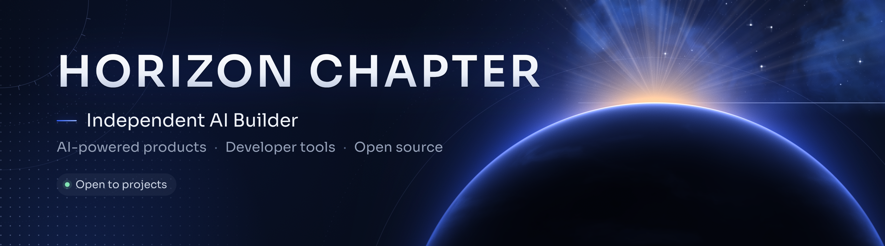

**Projets numériques, IA et workflows Claude · open source**
*Building online projects with AI, and sharing the tools along the way.*

---

## ✦ À propos · About

Je construis des projets numériques (jeux, apps, boutiques, automatisations) avec l'IA, et je partage ici les outils et méthodes qui marchent : skills Claude, plugins Claude Code, routines, modèles de travail.

I build digital projects with AI and share the tools and workflows that work: Claude skills, Claude Code plugins, routines, templates.

## ✦ Projets à découvrir

### Skills Claude
| Projet | Ce que c'est |
|---|---|
| [**clearmind**](https://github.com/horizonchapter/clearmind) | Skill de fond : lire toute la demande, signaler ce qui manque, ne rien inventer, répondre en moins de mots. |
| [**design-horizon**](https://github.com/horizonchapter/design-horizon) | Un seul point d'entrée pour un design d'interface beau, qui ne fait pas IA : chaîne en 8 étapes avec preuves. |
| [**publication-sure**](https://github.com/horizonchapter/publication-sure) | Tester un site ou une app avant la mise en ligne : sécurité, légal FR/UE, Lighthouse, verdict PASSE ou ÉCHOUE. |
| [**memoire-relais**](https://github.com/horizonchapter/memoire-relais) | Lire et noter la mémoire de son second cerveau, et passer le relais d'une session ou d'un chat sans rien perdre. |
| [**memoire-aios**](https://github.com/horizonchapter/memoire-aios) | Crée ton AIOS autour de Claude, pas à pas : un second cerveau Obsidian où tout est noté et relié. |
| [**pdf-sobre**](https://github.com/horizonchapter/pdf-sobre) | Des PDF A4 sobres et précis depuis du Markdown, sans page à moitié vide. |
| [**pdf-luxe**](https://github.com/horizonchapter/pdf-luxe) | Des PDF au rendu d'édition haut de gamme, générés en HTML/CSS. |
| [**decision-business**](https://github.com/horizonchapter/decision-business) | Démarrer un projet et décider avec des chiffres : STOP, PIVOT ou CONTINUER. |
| [**skill-booster**](https://github.com/horizonchapter/skill-booster) | Fusionner et améliorer des skills au lieu d'en multiplier, preuve avant/après. |
| [**filtre-ia**](https://github.com/horizonchapter/filtre-ia) | Retirer l'aspect « fait par une IA » d'une interface. |
| [**oeil-humain**](https://github.com/horizonchapter/oeil-humain) | Contrôle esthétique d'une vidéo courte avant publication. |
| [**roblox-skills**](https://github.com/horizonchapter/roblox-skills) | 4 skills pour créer des jeux Roblox avec Claude. |

### Plugins, mods, agents, modèles
| Projet | Ce que c'est |
|---|---|
| [**chef-employe**](https://github.com/horizonchapter/chef-employe) | Plugin Claude Code : déléguer le travail mécanique à des sous-agents moins chers, vérifier, mesurer. |
| [**mods-claude-code**](https://github.com/horizonchapter/mods-claude-code) | 4 mods pour l'app Claude Code : Jauge+ (jauge et relais), Cap (suites cliquables), Fil (progression), Plume (réécriture de dictée). |
| [**claude-subagents**](https://github.com/horizonchapter/claude-subagents) | 5 sous-agents Claude Code : chercheur, relecteur, chiffreur, trieur, expert Roblox. |
| [**claude-second-brain**](https://github.com/horizonchapter/claude-second-brain) | Modèles `CLAUDE.md` / `STATE.md` / `DECISIONS.md` pour que Claude et Claude Code se passent le relais. |
| [**claude-routines**](https://github.com/horizonchapter/claude-routines) | 4 routines Claude programmées rangées dans Notion. |
| [**horizon-aios**](https://github.com/horizonchapter/horizon-aios) | Ma méthode de travail avec Claude : un second cerveau, une équipe d'agents, des outils maison. |

### Archivés (remplacés)
[grill-me](https://github.com/horizonchapter/grill-me) et [chiffrage-projet](https://github.com/horizonchapter/chiffrage-projet) -> decision-business · [context-transfer](https://github.com/horizonchapter/context-transfer) -> memoire-relais · [checklist-lancement-web](https://github.com/horizonchapter/checklist-lancement-web) -> publication-sure

## ✦ Ce que j'explore

- Claude Code : skills, plugins, mods, automatisations
- Organisation du travail avec l'IA (mémoire, relais, routines)
- Design de documents et d'interfaces

## ✦ Me contacter

Ouvre une **issue** sur l'un des dépôts : c'est le moyen le plus simple.

Tout ce que je publie est sous licence MIT, sauf mention contraire.
