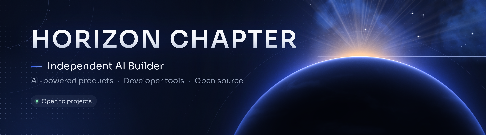

**Projets numériques, IA et workflows Claude · open source**
*Building online projects with AI, and sharing the tools along the way.*

---

## ✦ À propos · About

Je construis des projets numériques (jeux, apps, boutiques, automatisations) avec l'IA, et je partage ici les outils et méthodes qui marchent : skills Claude, plugins Claude Code, routines, modèles de travail.

I build digital projects with AI and share the tools and workflows that work: Claude skills, Claude Code plugins, routines, templates.

## ✦ Projets à découvrir

| Projet | Ce que c'est |
|---|---|
| [**horizon-aios**](https://github.com/horizonchapter/horizon-aios) | Ma méthode de travail avec Claude : un second cerveau, une équipe d'agents, des outils maison. |
| [**pdf-luxe**](https://github.com/horizonchapter/pdf-luxe) | Skill Claude : des PDF au rendu d'édition haut de gamme, générés en HTML/CSS. |
| [**chef-employe**](https://github.com/horizonchapter/chef-employe) | Plugin Claude Code : déléguer le travail mécanique à des sous-agents moins chers, vérifier, mesurer. |
| [**mods-claude-code**](https://github.com/horizonchapter/mods-claude-code) | 4 mods pour l'app Claude Code : jauge de contexte et relais (Jauge+), suites cliquables (Cap), barres de progression (Fil), réécriture de dictée (Plume). |
| [**claude-second-brain**](https://github.com/horizonchapter/claude-second-brain) | Mon « second cerveau » : modèles `CLAUDE.md` / `STATE.md` et skills pour que Claude et Claude Code se passent le relais. |
| [**claude-routines**](https://github.com/horizonchapter/claude-routines) | 4 routines Claude programmées (veille, mail famille, suivi du soir, revue hebdo) rangées dans Notion. |
| [**context-transfer**](https://github.com/horizonchapter/context-transfer) | Skill de passation : reprendre dans un nouveau chat exactement où on s'était arrêté, sans rien perdre. |
| [**memoire-aios**](https://github.com/horizonchapter/memoire-aios) | Crée ton AIOS autour de Claude et un second cerveau Obsidian où tout est noté et relié. |
| [**grill-me**](https://github.com/horizonchapter/grill-me) | Se faire interroger, une question à la fois, pour solidifier un projet avant de le lancer. Inspiré de Matt Pocock. |
| [**chiffrage-projet**](https://github.com/horizonchapter/chiffrage-projet) | Chiffrer un projet avant de le lancer : marge nette, point mort, 3 scénarios, décision STOP / PIVOT / CONTINUER. |
| [**checklist-lancement-web**](https://github.com/horizonchapter/checklist-lancement-web) | Tout vérifier avant de publier un site, une boutique ou un SaaS : sécurité, RGPD, SEO, tests réels. |
| [**roblox-skills**](https://github.com/horizonchapter/roblox-skills) | 4 skills pour créer des jeux Roblox avec Claude : chef de chantier, direction artistique, game feel, Roblox Studio. |
| [**oeil-humain**](https://github.com/horizonchapter/oeil-humain) | Contrôle esthétique d'une vidéo courte avant publication, du point de vue d'un vrai spectateur. |
| [**filtre-ia**](https://github.com/horizonchapter/filtre-ia) | Retirer l'aspect « fait par une IA » d'une interface pour qu'elle paraisse conçue par un studio. |
| [**claude-subagents**](https://github.com/horizonchapter/claude-subagents) | 5 sous-agents Claude Code : chercheur, relecteur, chiffreur, trieur, expert Roblox. |

## ✦ Ce que j'explore

- Claude Code : skills, plugins, mods, automatisations
- Organisation du travail avec l'IA (mémoire, relais, routines)
- Design de documents et d'interfaces

## ✦ Me contacter

Ouvre une **issue** sur l'un des dépôts : c'est le moyen le plus simple.

Tout ce que je publie est sous licence MIT, sauf mention contraire.
